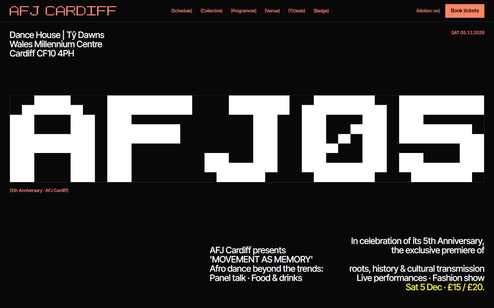
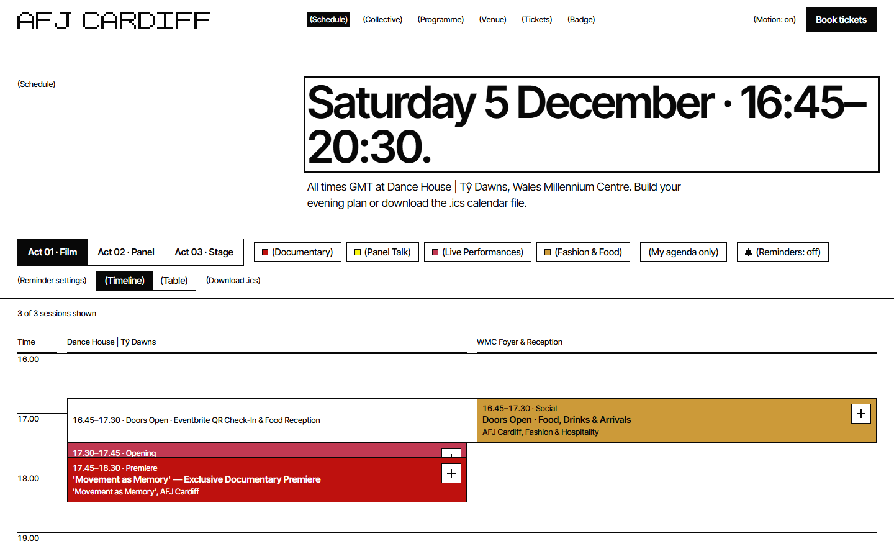
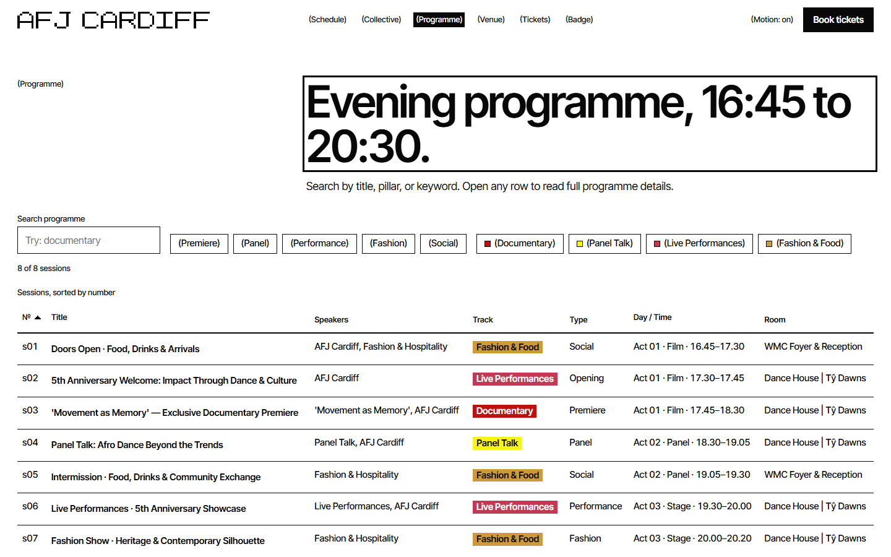
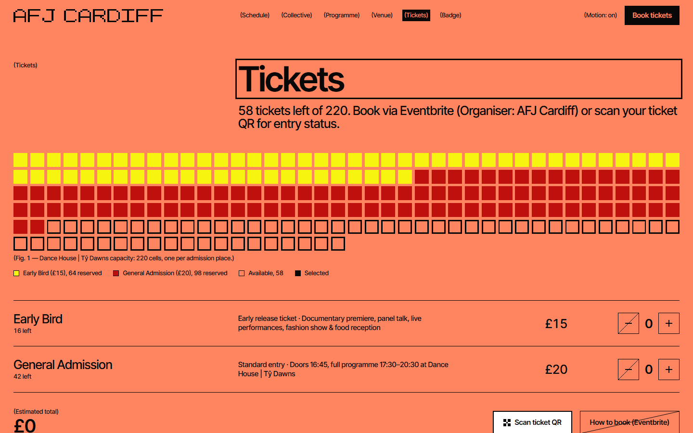
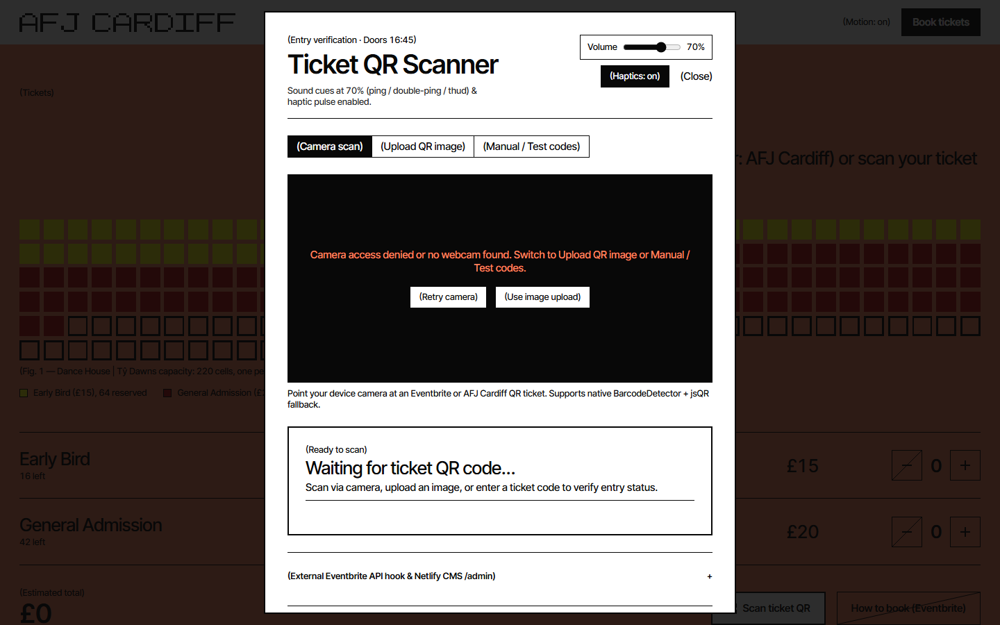
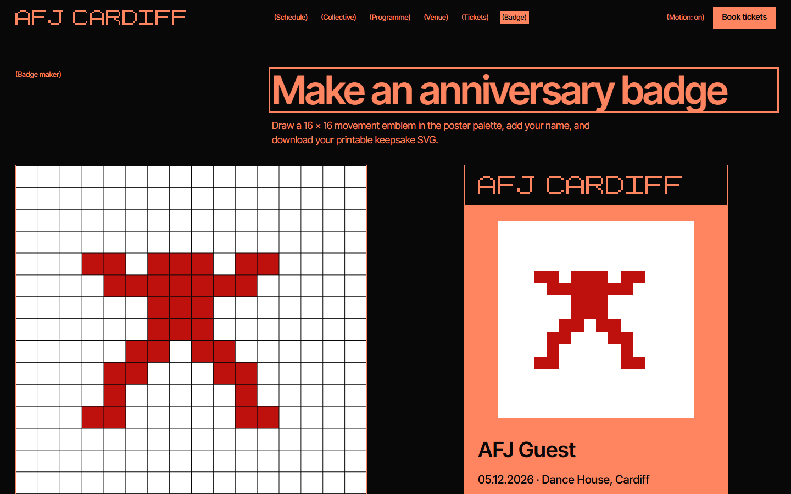

# AFJ Cardiff — Movement as Memory

> In celebration of its 5th Anniversary, **AFJ Cardiff** presents the exclusive premiere of **"Movement as Memory"** — an original documentary on Afro dance beyond the trends — plus panel talk, food & drinks, live performances, and a fashion show at **Dance House | Tŷ Dawns, Wales Millennium Centre, Cardiff**.

- **Date:** Saturday 5 December 2026
- **Doors:** 16:45 · **Programme:** 17:30–20:30 (GMT)
- **Venue:** Dance House | Tŷ Dawns, Wales Millennium Centre, Pierhead St, Cardiff CF10 4PH
- **Tickets:** Early Bird £15 · General Admission £20 (via Eventbrite, organiser: AFJ Cardiff)
- **Capacity:** 220

---

## What this repo is

A single-page, zero-backend event site plus an on-the-door **QR ticket scanner** and a **Netlify CMS** for editing event/ticket data. It is a Vite MPA (multi-page app) built from the Google AI Studio template, shipped as one self-contained `index.html` (all CSS and JS inlined) with a Vite dev server and a static build output.

## Features

- **8-section landing page** — hero particle canvas, about, in-numbers countdown, four programme pillars, three-act programme, evening highlights, official poster wall, ticket capacity grid.
- **Six routed views** — Home, Schedule, Collective (speakers), Programme (talks), Venue, Tickets + Badge maker.
- **Agenda builder** — add sessions to a personal agenda, clash detection, localStorage persistence.
- **Capacity grid** — 220-cell SVG grid visualising sold vs. available places, with keyboard navigation and tooltips.
- **QR ticket scanner** — camera (BarcodeDetector + jsQR fallback), image upload, manual entry; verification against CMS pass registry + AFJ/Eventbrite formats; duplicate-scan detection; haptics, audio cues, CSV export, daily scan summary.
- **Agenda reminders** — browser notifications + in-app banner, configurable lead time and note.
- **Badge maker** — draw a 16×16 movement emblem in the poster palette and download as SVG.
- **Motion system** — respects `prefers-reduced-motion`, user toggle, pixel-wipe route transitions, pointer trail.
- **Netlify Decap CMS** at `/admin/` editing `public/data/cms-config.json`.
- **Accessibility** — semantic landmarks, focus-visible outlines, keyboard navigation on grids/maps, reduced-motion support, ARIA live regions.

## Tech stack

| Layer | Choice |
|---|---|
| Bundler | Vite 8 (MPA mode, `appType: 'mpa'`) |
| Language | TypeScript (type-check only, `tsc --noEmit`) |
| Runtime | Vanilla JS (no framework) in a single `index.html` |
| QR decode | `jsqr` + native `BarcodeDetector` |
| CMS | Netlify Decap CMS (`decap-cms@^3`), git-gateway backend |
| Fonts | Inter Tight (Google Fonts) |
| Package manager | npm (bun.lock also present) |

Dependencies: `@google/genai`, `jsqr`, `vite`. Dev: `typescript`, `@types/node`.

## Getting started

```bash
git clone https://github.com/andiekobbietks/AFJCardiff-Movement-as-Memory.git
cd AFJCardiff-Movement-as-Memory
npm install
npm run dev          # http://localhost:3000
```

```bash
npm run build        # outputs to dist/
npm run preview      # preview the build
npm run lint         # tsc --noEmit
```

> The `predev`/`prebuild` scripts guard `node_modules/.bin`; on Windows (cmd/PowerShell) the `[ -d ... ]` test is a no-op failure but `npm install` still runs and is harmless.

## Project structure

```
.
├── index.html              # The whole app: styles + data + logic (single file)
├── index.css               # (empty — styles live in index.html)
├── metadata.json           # AI Studio project metadata
├── package.json
├── tsconfig.json
├── vite.config.ts          # MPA discovery, importmap sync, static asset copy
├── public/
│   ├── admin/
│   │   ├── index.html      # Decap CMS entry (Netlify Identity)
│   │   └── config.yml      # CMS collections (event, tickets, scanner)
│   ├── assets/aistudio/    # Banner/poster images
│   └── data/
│       └── cms-config.json # Runtime-hydrated tickets + scanner pass registry
└── docs/
    ├── screenshots/       # User-journey screenshots (this README)
    └── videos/            # Interaction-pattern WebMs (this README)
```

## Routes

Hash-based routing (`#/...`):

| Route | View |
|---|---|
| `#/` | Home — 8 sections |
| `#/schedule` | Full programme timeline (filterable by day/track) |
| `#/speakers` | Collective — five pillars, portraits, hover swap |
| `#/speakers/:id` | Speaker detail |
| `#/talks` | Programme table — search, sort, expandable rows |
| `#/talks/:id` | Talk detail (deep-linked row) |
| `#/venue` | Interactive floor plan + access info |
| `#/tickets` | Ticket tiers, capacity grid, FAQ, QR scanner dialog |
| `#/badge` | Badge maker |

## User journeys (screenshots)

Each journey is collapsible. Screenshots are viewport captures (1440×900) of the running dev build.

<details>
<summary><strong>1. Home — hero, about, numbers, pillars, programme, poster wall, tickets</strong></summary>



The hero particle canvas cycles through three glyphs (AFJ05 / 05/12 / 17:30). Below: about, in-numbers countdown to doors, four programme pillars, three-act programme, evening highlights, official poster with Eventbrite QR, and the 220-cell capacity grid with "Book tickets" CTA.

</details>

<details>
<summary><strong>2. Schedule — full programme timeline</strong></summary>



Filterable by day (three acts) and track; toggle sessions into a personal agenda with clash detection. Agenda persists in localStorage and feeds the reminder engine.

</details>

<details>
<summary><strong>3. Collective (speakers) — five pillars</strong></summary>


Five speaker cards (AFJ Cardiff, documentary, panel, live performances, fashion & hospitality) with procedurally rendered 32×32 portrait canvases that assemble on scroll and invert on hover.

</details>

<details>
<summary><strong>4. Speaker detail</strong></summary>


Deep-linked speaker view with bio, track, and full portrait.

</details>

<details>
<summary><strong>5. Programme (talks) — searchable, sortable table</strong></summary>



Search by title/pillar/keyword, filter by type and track, sort by column, expand any row for the full abstract and "add to agenda" action.

</details>

<details>
<summary><strong>6. Venue — interactive floor plan</strong></summary>


SVG floor plan of Dance House | Tŷ Dawns (Dance House, Runway Prep, Quiet lounge, Check-In, WMC Foyer). Hover/focus/click a space to inspect seating, level and access features. Getting-there and access lists below.

</details>

<details>
<summary><strong>7. Tickets — tiers, capacity grid, FAQ</strong></summary>



Early Bird £15 and General Admission £20 steppers (max 4 each), live estimated total, 220-cell capacity grid that fills as places are reserved, "How to book (Eventbrite)" dialog, and the FAQ accordion.

</details>

<details>
<summary><strong>8. QR ticket scanner dialog</strong></summary>



Camera (BarcodeDetector + jsQR fallback), image upload, and manual/test-code tabs. Result box shows valid / already-checked-in / invalid with tier, holder, source. Includes volume slider, haptics toggle, scan history, CSV export, and daily scan summary by tier.

</details>

<details>
<summary><strong>9. Badge maker</strong></summary>



Draw a 16×16 movement emblem in the poster palette, add a name, download as SVG keepsake.

</details>

## Interaction patterns (video)

Short WebM captures of every key interaction, recorded from the dev build with a visible cursor (desktop) or touch ripples (mobile). Each is collapsible, with a step-by-step operating procedure.

### Home

<details>
<summary><strong>Hero canvas — cycle glyphs on click</strong></summary>

<video src="https://raw.githubusercontent.com/andiekobbietks/AFJCardiff-Movement-as-Memory/main/docs/videos/hero-cycle.webm" controls width="100%"></video>

**Goal:** Cycle the hero particle canvas through its three glyphs.
**Preconditions:** Home route loaded, motion on.
**Steps:** Click the hero canvas. Repeat. Each click advances AFJ05 → 05/12 → 17:30.
**Expected:** Particles morph to the next glyph with a 900 ms ease; caption updates.
**Notes:** With motion off, the canvas is static (no morph).

</details>

<details>
<summary><strong>Poster wall — press a tile to cycle colours</strong></summary>

<video src="https://raw.githubusercontent.com/andiekobbietks/AFJCardiff-Movement-as-Memory/main/docs/videos/poster-wall.webm" controls width="100%"></video>

**Goal:** Recolour a poster-wall tile.
**Preconditions:** Home route, poster section visible.
**Steps:** Click any tile in the interactive weave beside the official poster.
**Expected:** Tile colour cycles through the poster ramp; neighbours are unaffected.
**Notes:** Purely cosmetic; no state persisted.

</details>

<details>
<summary><strong>Capacity grid — fill animation + keyboard navigation</strong></summary>

<video src="https://raw.githubusercontent.com/andiekobbietks/AFJCardiff-Movement-as-Memory/main/docs/videos/capacity-grid.webm" controls width="100%"></video>

**Goal:** Watch the 220-cell grid fill and navigate it by keyboard.
**Preconditions:** Home or Tickets route, grid in viewport.
**Steps:** Scroll so the grid is 30% visible; the reserved cells fill in batches of 6. Then focus the grid and press ArrowRight/ArrowDown.
**Expected:** Sold cells paint in their tier colour; focus ring moves; tooltip shows seat info.
**Notes:** With motion off, the grid paints instantly.

</details>

<details>
<summary><strong>Stats — count-up on scroll</strong></summary>

<video src="https://raw.githubusercontent.com/andiekobbietks/AFJCardiff-Movement-as-Memory/main/docs/videos/stats-countup.webm" controls width="100%"></video>

**Goal:** Trigger the animated count-up of the five stat glyphs.
**Preconditions:** Home route, stats row 50% visible, motion on.
**Steps:** Scroll to the in-numbers section.
**Expected:** Each stat counts from 0 to its value over ~1.2 s, staggered by index.
**Notes:** Does not re-run once shown.

</details>

<details>
<summary><strong>Motion toggle — on/off</strong></summary>

<video src="https://raw.githubusercontent.com/andiekobbietks/AFJCardiff-Movement-as-Memory/main/docs/videos/motion-toggle.webm" controls width="100%"></video>

**Goal:** Toggle site-wide motion and persist the choice.
**Preconditions:** Any route.
**Steps:** Click the desktop motion button (or mobile). Click again to restore.
**Expected:** All animations pause/resume; preference saved to localStorage (`afj5.motion`); button label flips (Motion: on/off).
**Notes:** Respects `prefers-reduced-motion` on first load.

</details>

<details>
<summary><strong>Tooltip — hover hint</strong></summary>

<video src="https://raw.githubusercontent.com/andiekobbietks/AFJCardiff-Movement-as-Memory/main/docs/videos/tooltip-demo.webm" controls width="100%"></video>

**Goal:** Show the floating tooltip on hover.
**Preconditions:** Desktop pointer (fine pointer media query).
**Steps:** Hover a nav link or capacity cell.
**Expected:** Tooltip appears after 120 ms, positioned to avoid viewport edges.
**Notes:** Esc hides it.

</details>

### Schedule

<details>
<summary><strong>Schedule — day/track filters + view toggle</strong></summary>

<video src="https://raw.githubusercontent.com/andiekobbietks/AFJCardiff-Movement-as-Memory/main/docs/videos/schedule-filters.webm" controls width="100%"></video>

**Goal:** Filter the programme by day and track and switch views.
**Preconditions:** Schedule route.
**Steps:** Click day tabs (Act 01/02/03), toggle track chips, click (Table) then (Timeline).
**Expected:** Session list re-filters instantly; view persists to localStorage (`afj5.filters`).
**Notes:** Agenda-only filter available via the agenda button.

</details>

<details>
<summary><strong>Schedule — add to agenda + reminders panel</strong></summary>

<video src="https://raw.githubusercontent.com/andiekobbietks/AFJCardiff-Movement-as-Memory/main/docs/videos/schedule-agenda.webm" controls width="100%"></video>

**Goal:** Toggle a session into the personal agenda and open the reminders panel.
**Preconditions:** Schedule route.
**Steps:** Click (Add to agenda) on a session; open the reminders panel; set lead time and note; close.
**Expected:** Agenda persists (`afj5.agenda`); clash detection flags overlapping sessions; reminders panel saves to `afj5.reminders`.
**Notes:** Reminders need browser notification permission.

</details>

### Collective (speakers)

<details>
<summary><strong>Speaker portrait — hover palette swap</strong></summary>

<video src="https://raw.githubusercontent.com/andiekobbietks/AFJCardiff-Movement-as-Memory/main/docs/videos/speaker-hover.webm" controls width="100%"></video>

**Goal:** Invert a speaker portrait palette on hover.
**Preconditions:** Speakers route, motion on, hover-capable pointer.
**Steps:** Hover a speaker card; move away.
**Expected:** Portrait colours swap via a diagonal wave sweep (~360 ms); reverts on leave.
**Notes:** With motion off, swap is instant.

</details>

### Programme (talks)

<details>
<summary><strong>Talks — search, sort, type/track filters</strong></summary>

<video src="https://raw.githubusercontent.com/andiekobbietks/AFJCardiff-Movement-as-Memory/main/docs/videos/talks-search-sort-filter.webm" controls width="100%"></video>

**Goal:** Search, filter and sort the programme table.
**Preconditions:** Talks route.
**Steps:** Type "panel" in search; clear; toggle a type chip; toggle a track chip; click a column header to sort; click again to reverse.
**Expected:** Rows filter live; sort indicator flips; count updates.
**Notes:** Search normalises diacritics.

</details>

<details>
<summary><strong>Talks — expand row + add to agenda</strong></summary>

<video src="https://raw.githubusercontent.com/andiekobbietks/AFJCardiff-Movement-as-Memory/main/docs/videos/talks-expand-agenda.webm" controls width="100%"></video>

**Goal:** Expand a talk row and add it to the agenda.
**Preconditions:** Talks route.
**Steps:** Click a talk title to expand; click (Add to agenda); click the title again to collapse.
**Expected:** Abstract + speakers shown; agenda state toggles and persists.
**Notes:** Deep-link via `#/talks/:id` scrolls to the row.

</details>

### Venue

<details>
<summary><strong>Venue plan — hover/click spaces</strong></summary>

<video src="https://raw.githubusercontent.com/andiekobbietks/AFJCardiff-Movement-as-Memory/main/docs/videos/venue-plan.webm" controls width="100%"></video>

**Goal:** Inspect a space on the floor plan.
**Preconditions:** Venue route.
**Steps:** Hover or click a space (or its room button); press Enter/Space on a focused space.
**Expected:** Selected space fills with its tier colour; details panel updates (name, level, seats, features).
**Notes:** Keyboard-accessible (Tab + Enter/Space).

</details>

### Tickets

<details>
<summary><strong>Tickets — quantity steppers + total + capacity keyboard</strong></summary>

<video src="https://raw.githubusercontent.com/andiekobbietks/AFJCardiff-Movement-as-Memory/main/docs/videos/tickets-stepper.webm" controls width="100%"></video>

**Goal:** Adjust ticket quantities and navigate the capacity grid.
**Preconditions:** Tickets route.
**Steps:** Click +/− steppers (max 4 per tier); watch estimated total and grid selection update; focus the grid and use arrow keys.
**Expected:** Total recomputes; selected overlay animates; capacity grid focus ring moves with tooltip.
**Notes:** Steppers disable at 0 or max.

</details>

<details>
<summary><strong>Tickets — "How to book" Eventbrite dialog</strong></summary>

<video src="https://raw.githubusercontent.com/andiekobbietks/AFJCardiff-Movement-as-Memory/main/docs/videos/tickets-eventbrite-dialog.webm" controls width="100%"></video>

**Goal:** Open the booking hand-off dialog.
**Preconditions:** At least one ticket selected.
**Steps:** Click (How to book (Eventbrite)).
**Expected:** Modal shows selected tiers/total and directs to Eventbrite (organiser: AFJ Cardiff) or email.
**Notes:** Button is disabled when quantity is 0.

</details>

<details>
<summary><strong>QR scanner — camera/upload/manual tabs</strong></summary>

<video src="https://raw.githubusercontent.com/andiekobbietks/AFJCardiff-Movement-as-Memory/main/docs/videos/qr-scanner-tabs.webm" controls width="100%"></video>

**Goal:** Switch QR input methods.
**Preconditions:** Tickets route, scanner dialog open.
**Steps:** Click (Camera scan), (Upload QR image), (Manual / Test codes) tabs.
**Expected:** Corresponding panel shows; camera initialises (secure context required).
**Notes:** Camera needs HTTPS/localhost + permission.

</details>

<details>
<summary><strong>QR scanner — manual code verification</strong></summary>

<video src="https://raw.githubusercontent.com/andiekobbietks/AFJCardiff-Movement-as-Memory/main/docs/videos/qr-scanner-manual.webm" controls width="100%"></video>

**Goal:** Verify a ticket code manually.
**Preconditions:** Scanner dialog open, Manual tab active.
**Steps:** Enter `AFJ-EB-2026-001` → submit (valid). Then enter `AFJ-USED-2026-004` → submit (already checked in).
**Expected:** Result box shows tier, holder, source and status; audio cue + haptic (valid); daily summary increments.
**Notes:** Also accepts Eventbrite URLs, barcodes, JSON payloads.

</details>

<details>
<summary><strong>QR scanner — volume and haptics settings</strong></summary>

<video src="https://raw.githubusercontent.com/andiekobbietks/AFJCardiff-Movement-as-Memory/main/docs/videos/qr-scanner-settings.webm" controls width="100%"></video>

**Goal:** Adjust scan audio volume and haptics.
**Preconditions:** Scanner dialog open.
**Steps:** Drag/arrow the volume slider; toggle (Haptics: on/off).
**Expected:** Volume label updates; haptic note reflects state; settings persist to localStorage.
**Notes:** Haptics require `navigator.vibrate` support.

</details>

### Reminders & navigation

<details>
<summary><strong>Reminder panel — configure lead time and note</strong></summary>

<video src="https://raw.githubusercontent.com/andiekobbietks/AFJCardiff-Movement-as-Memory/main/docs/videos/reminder-panel.webm" controls width="100%"></video>

**Goal:** Configure agenda reminder lead time and note.
**Preconditions:** Schedule route.
**Steps:** Open reminders panel; set minutes (1–180); type a note; close.
**Expected:** Settings persist (`afj5.reminders`); armed sessions list updates.
**Notes:** Requires notification permission for OS-level alerts.

</details>

<details>
<summary><strong>Top button — scroll to top</strong></summary>

<video src="https://raw.githubusercontent.com/andiekobbietks/AFJCardiff-Movement-as-Memory/main/docs/videos/top-button.webm" controls width="100%"></video>

**Goal:** Scroll back to the top.
**Preconditions:** Any long page, scrolled down.
**Steps:** Click the (Top) button (appears after one viewport of scroll).
**Expected:** Smooth scroll to top (or instant if motion off).
**Notes:** Button surface colour adapts to the section in view.

</details>

### Badge maker

<details>
<summary><strong>Badge — draw, name, preview</strong></summary>

<video src="https://raw.githubusercontent.com/andiekobbietks/AFJCardiff-Movement-as-Memory/main/docs/videos/badge-draw.webm" controls width="100%"></video>

**Goal:** Draw an emblem and set a name.
**Preconditions:** Badge route.
**Steps:** Pick a palette colour; click cells on the 16×16 grid; type a name in the input.
**Expected:** Grid updates; preview reflects changes; downloadable as SVG.
**Notes:** Grid persists to localStorage (`afj5.badge`).

</details>

### Mobile (touch)

<details>
<summary><strong>Mobile menu — touch open/close</strong></summary>

<video src="https://raw.githubusercontent.com/andiekobbietks/AFJCardiff-Movement-as-Memory/main/docs/videos/mobile-menu-touch.webm" controls width="100%"></video>

**Goal:** Open and close the mobile menu by touch.
**Preconditions:** Mobile viewport (≤767 px).
**Steps:** Tap the hamburger; tap close (or a link).
**Expected:** Pixel-wipe plays; menu opens/closes; focus moves to close button.
**Notes:** Body scroll locked while open.

</details>

<details>
<summary><strong>Mobile tickets — touch steppers and QR scanner</strong></summary>

<video src="https://raw.githubusercontent.com/andiekobbietks/AFJCardiff-Movement-as-Memory/main/docs/videos/mobile-tickets-touch.webm" controls width="100%"></video>

**Goal:** Adjust quantities and open the scanner on touch.
**Preconditions:** Mobile viewport, Tickets route.
**Steps:** Tap + twice; tap (Scan ticket QR).
**Expected:** Quantity and total update; scanner dialog opens with touch-friendly tabs.
**Notes:** Steppers are 44 px minimum touch targets.

</details>

<details>
<summary><strong>Mobile schedule — touch day switch and scroll</strong></summary>

<video src="https://raw.githubusercontent.com/andiekobbietks/AFJCardiff-Movement-as-Memory/main/docs/videos/mobile-schedule-touch.webm" controls width="100%"></video>

**Goal:** Switch days and scroll the programme on touch.
**Preconditions:** Mobile viewport, Schedule route.
**Steps:** Tap Act 02 tab; scroll down and back up.
**Expected:** Session list updates; scroll is smooth (motion on).
**Notes:** Agenda toggle available per session.

</details>

## Ticketing & capacity

- **Early Bird** — £15, 80 allocation, 64 sold (16 left).
- **General Admission** — £20, 140 allocation, 98 sold (42 left).
- Capacity 220 total; `DATA.meta.capacity` drives the grid.
- Official checkout happens on Eventbrite (organiser: AFJ Cardiff); this site previews tiers and links out. The "How to book" dialog generates an Eventbrite hand-off message.

## QR scanner verification flow

1. **External API** (if `verifyEndpoint` set) — POST `{ code, raw, event }`, accept `status`/`valid`.
2. **Local check-in log** — duplicate scan detection from `localStorage`.
3. **CMS pass registry** — `public/data/cms-config.json` → `scanner.passes` (status: `valid` / `checked_in` / `revoked`).
4. **Format fallback** — accepted prefixes (`AFJ-`, `EB-`, `EVT-`, `WMC-`), Eventbrite URLs, 10–24 digit barcodes, JSON payloads.

Scan results record to a per-device daily summary (unique tickets, by tier) and can be exported as CSV.

## Content management (Netlify CMS)

Admin UI at `/admin/` (Decap CMS, git-gateway backend on `main`).

Editable via `public/admin/config.yml` → collection `afj_config` → file `public/data/cms-config.json`:

- Event details (organiser, subtitle, date, doors, venue).
- Ticket tiers (id, name, price, allocation, sold, left, includes, colour).
- QR scanner (verify endpoint, Eventbrite organiser, accepted prefixes, registered passes with status).

Media uploads go to `public/assets/uploads`.

> Note: `index.html` hardcodes the full event copy, schedule, speakers, FAQ, venue plan and capacity in its `DATA` object. The CMS hydrates only **tickets** and **scanner passes** at runtime (`loadCmsConfig`). Editing other content requires editing `index.html`.

## Configuration

`.env.example`:

```
GEMINI_API_KEY=
```

The `@google/genai` dependency is present but the shipped app does not call it; the key is a template leftover. The scanner's optional verification endpoint is set in the CMS (`scanner.verifyEndpoint`) or in the in-app settings dialog.

## Accessibility & motion

- `prefers-reduced-motion: reduce` disables animations and instant-renders.
- User motion toggle persisted to `localStorage` (`afj5.motion`).
- Focus-visible 3px outlines; keyboard navigation on capacity grid and venue plan; ARIA live regions for countdown and scan results.
- Reduced-motion also pauses haptics/audio cues appropriately.

## Browser support

Modern evergreen browsers. Camera scanning requires a secure context (HTTPS or localhost) and `getUserMedia`. `BarcodeDetector` is used where available, falling back to `jsQR`. Audio cues use Web Audio; haptics use `navigator.vibrate` where supported.

## License

No license file present in the repository; all rights reserved by AFJ Cardiff unless stated otherwise. Contact `afjcardiff@gmail.com` for press, partnerships, or accessibility requests.

---

_Screenshots captured from the dev build (`npm run dev`, port 3000) on 2026-11-28._
