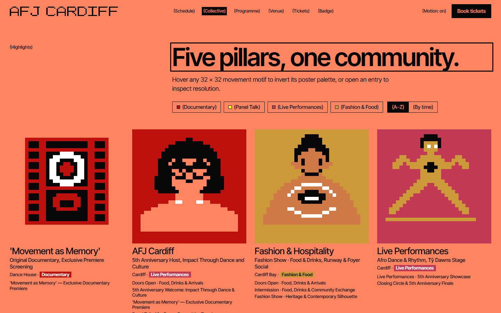
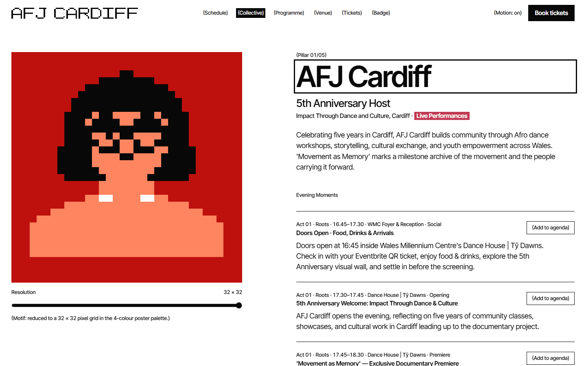
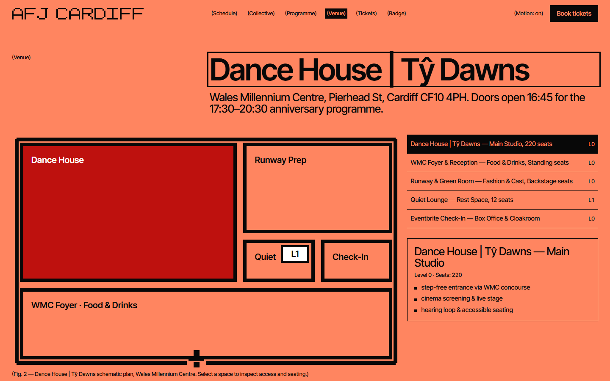

# AFJ Cardiff — Movement as Memory

> In celebration of its 5th Anniversary, **AFJ Cardiff** presents the exclusive premiere of **"Movement as Memory"** — an original documentary on Afro dance beyond the trends — plus panel talk, food & drinks, live performances, and a fashion show at **Dance House | Tŷ Dawns, Wales Millennium Centre, Cardiff**.

- **Date:** Saturday 5 December 2026
- **Doors:** 16:45 · **Programme:** 17:30–20:30 (GMT)
- **Venue:** Dance House | Tŷ Dawns, Wales Millennium Centre, Pierhead St, Cardiff CF10 4PH
- **Tickets:** Early Bird £15 · General Admission £20 (via Eventbrite, organiser: AFJ Cardiff)
- **Capacity:** 220

---

## What this repo is

A single-page, zero-backend event site plus an on-the-door **QR ticket scanner** and a **Netlify CMS** for editing event/ticket data. It is a Vite MPA (multi-page app) built from the Google AI Studio template, shipped as one self-contained `index.html` (all CSS and JS inlined) with a Vite dev server and a static build output.

## Features

- **8-section landing page** — hero particle canvas, about, in-numbers countdown, four programme pillars, three-act programme, evening highlights, official poster wall, ticket capacity grid.
- **Six routed views** — Home, Schedule, Collective (speakers), Programme (talks), Venue, Tickets + Badge maker.
- **Agenda builder** — add sessions to a personal agenda, clash detection, localStorage persistence.
- **Capacity grid** — 220-cell SVG grid visualising sold vs. available places, with keyboard navigation and tooltips.
- **QR ticket scanner** — camera (BarcodeDetector + jsQR fallback), image upload, manual entry; verification against CMS pass registry + AFJ/Eventbrite formats; duplicate-scan detection; haptics, audio cues, CSV export, daily scan summary.
- **Agenda reminders** — browser notifications + in-app banner, configurable lead time and note.
- **Badge maker** — draw a 16×16 movement emblem in the poster palette and download as SVG.
- **Motion system** — respects `prefers-reduced-motion`, user toggle, pixel-wipe route transitions, pointer trail.
- **Netlify Decap CMS** at `/admin/` editing `public/data/cms-config.json`.
- **Accessibility** — semantic landmarks, focus-visible outlines, keyboard navigation on grids/maps, reduced-motion support, ARIA live regions.

## Tech stack

| Layer | Choice |
|---|---|
| Bundler | Vite 8 (MPA mode, `appType: 'mpa'`) |
| Language | TypeScript (type-check only, `tsc --noEmit`) |
| Runtime | Vanilla JS (no framework) in a single `index.html` |
| QR decode | `jsqr` + native `BarcodeDetector` |
| CMS | Netlify Decap CMS (`decap-cms@^3`), git-gateway backend |
| Fonts | Inter Tight (Google Fonts) |
| Package manager | npm (bun.lock also present) |

Dependencies: `@google/genai`, `jsqr`, `vite`. Dev: `typescript`, `@types/node`.

## Getting started

```bash
git clone https://github.com/andiekobbietks/AFJCardiff-Movement-as-Memory.git
cd AFJCardiff-Movement-as-Memory
npm install
npm run dev          # http://localhost:3000
```

```bash
npm run build        # outputs to dist/
npm run preview      # preview the build
npm run lint         # tsc --noEmit
```

> The `predev`/`prebuild` scripts guard `node_modules/.bin`; on Windows (cmd/PowerShell) the `[ -d ... ]` test is a no-op failure but `npm install` still runs and is harmless.

## Project structure

```
.
├── index.html              # The whole app: styles + data + logic (single file)
├── index.css               # (empty — styles live in index.html)
├── metadata.json           # AI Studio project metadata
├── package.json
├── tsconfig.json
├── vite.config.ts          # MPA discovery, importmap sync, static asset copy
├── public/
│   ├── admin/
│   │   ├── index.html      # Decap CMS entry (Netlify Identity)
│   │   └── config.yml      # CMS collections (event, tickets, scanner)
│   ├── assets/aistudio/    # Banner/poster images
│   └── data/
│       └── cms-config.json # Runtime-hydrated tickets + scanner pass registry
└── docs/screenshots/       # User-journey screenshots (this README)
```

## Routes

Hash-based routing (`#/...`):

| Route | View |
|---|---|
| `#/` | Home — 8 sections |
| `#/schedule` | Full programme timeline (filterable by day/track) |
| `#/speakers` | Collective — five pillars, portraits, hover swap |
| `#/speakers/:id` | Speaker detail |
| `#/talks` | Programme table — search, sort, expandable rows |
| `#/talks/:id` | Talk detail (deep-linked row) |
| `#/venue` | Interactive floor plan + access info |
| `#/tickets` | Ticket tiers, capacity grid, FAQ, QR scanner dialog |
| `#/badge` | Badge maker |

## User journeys (screenshots)

Each journey is collapsible. Screenshots are viewport captures (1440×900) of the running dev build.

<details>
<summary><strong>1. Home — hero, about, numbers, pillars, programme, poster wall, tickets</strong></summary>


The hero particle canvas cycles through three glyphs (AFJ05 / 05/12 / 17:30). Below: about, in-numbers countdown to doors, four programme pillars, three-act programme, evening highlights, official poster with Eventbrite QR, and the 220-cell capacity grid with "Book tickets" CTA.

</details>

<details>
<summary><strong>2. Schedule — full programme timeline</strong></summary>


Filterable by day (three acts) and track; toggle sessions into a personal agenda with clash detection. Agenda persists in localStorage and feeds the reminder engine.

</details>

<details>
<summary><strong>3. Collective (speakers) — five pillars</strong></summary>



Five speaker cards (AFJ Cardiff, documentary, panel, live performances, fashion & hospitality) with procedurally rendered 32×32 portrait canvases that assemble on scroll and invert on hover.

</details>

<details>
<summary><strong>4. Speaker detail</strong></summary>



Deep-linked speaker view with bio, track, and full portrait.

</details>

<details>
<summary><strong>5. Programme (talks) — searchable, sortable table</strong></summary>


Search by title/pillar/keyword, filter by type and track, sort by column, expand any row for the full abstract and "add to agenda" action.

</details>

<details>
<summary><strong>6. Venue — interactive floor plan</strong></summary>



SVG floor plan of Dance House | Tŷ Dawns (Dance House, Runway Prep, Quiet lounge, Check-In, WMC Foyer). Hover/focus/click a space to inspect seating, level and access features. Getting-there and access lists below.

</details>

<details>
<summary><strong>7. Tickets — tiers, capacity grid, FAQ</strong></summary>


Early Bird £15 and General Admission £20 steppers (max 4 each), live estimated total, 220-cell capacity grid that fills as places are reserved, "How to book (Eventbrite)" dialog, and the FAQ accordion.

</details>

<details>
<summary><strong>8. QR ticket scanner dialog</strong></summary>


Camera (BarcodeDetector + jsQR fallback), image upload, and manual/test-code tabs. Result box shows valid / already-checked-in / invalid with tier, holder, source. Includes volume slider, haptics toggle, scan history, CSV export, and daily scan summary by tier.

</details>

<details>
<summary><strong>9. Badge maker</strong></summary>


Draw a 16×16 movement emblem in the poster palette, add a name, download as SVG keepsake.

</details>

## Interaction patterns (video)

Short WebM captures of key interactions, recorded from the dev build. Each is collapsible.

<details>
<summary><strong>Hero canvas — cycling glyphs on click</strong></summary>

<video src="docs/videos/hero-cycle.webm" controls width="100%"></video>

The hero particle canvas cycles through three glyphs (AFJ05 → 05/12 → 17:30) on click, with particle morph animation.

</details>

<details>
<summary><strong>Mobile menu — pixel-wipe transition</strong></summary>

<video src="docs/videos/menu-wipe.webm" controls width="100%"></video>

Opening/closing the mobile menu plays the diagonal pixel-wipe overlay (motion on).

</details>

<details>
<summary><strong>Speaker portrait — hover palette swap</strong></summary>

<video src="docs/videos/speaker-hover.webm" controls width="100%"></video>

Hovering a speaker card inverts the portrait palette via a wave sweep.

</details>

<details>
<summary><strong>Agenda — toggle a session into your plan</strong></summary>

<video src="docs/videos/agenda-toggle.webm" controls width="100%"></video>

Expanding a programme row and adding it to the agenda; clash detection highlights conflicts.

</details>

<details>
<summary><strong>QR scanner — manual code verification</strong></summary>

<video src="docs/videos/qr-scan.webm" controls width="100%"></video>

Manual tab: enter `AFJ-EB-2026-001`, submit, see the valid-ticket result with tier, holder and source.

</details>

<details>
<summary><strong>Badge maker — drawing an emblem</strong></summary>

<video src="docs/videos/badge-draw.webm" controls width="100%"></video>

Badge view load and grid interaction.

</details>

## Ticketing & capacity

- **Early Bird** — £15, 80 allocation, 64 sold (16 left).
- **General Admission** — £20, 140 allocation, 98 sold (42 left).
- Capacity 220 total; `DATA.meta.capacity` drives the grid.
- Official checkout happens on Eventbrite (organiser: AFJ Cardiff); this site previews tiers and links out. The "How to book" dialog generates an Eventbrite hand-off message.

## QR scanner verification flow

1. **External API** (if `verifyEndpoint` set) — POST `{ code, raw, event }`, accept `status`/`valid`.
2. **Local check-in log** — duplicate scan detection from `localStorage`.
3. **CMS pass registry** — `public/data/cms-config.json` → `scanner.passes` (status: `valid` / `checked_in` / `revoked`).
4. **Format fallback** — accepted prefixes (`AFJ-`, `EB-`, `EVT-`, `WMC-`), Eventbrite URLs, 10–24 digit barcodes, JSON payloads.

Scan results record to a per-device daily summary (unique tickets, by tier) and can be exported as CSV.

## Content management (Netlify CMS)

Admin UI at `/admin/` (Decap CMS, git-gateway backend on `main`).

Editable via `public/admin/config.yml` → collection `afj_config` → file `public/data/cms-config.json`:

- Event details (organiser, subtitle, date, doors, venue).
- Ticket tiers (id, name, price, allocation, sold, left, includes, colour).
- QR scanner (verify endpoint, Eventbrite organiser, accepted prefixes, registered passes with status).

Media uploads go to `public/assets/uploads`.

> Note: `index.html` hardcodes the full event copy, schedule, speakers, FAQ, venue plan and capacity in its `DATA` object. The CMS hydrates only **tickets** and **scanner passes** at runtime (`loadCmsConfig`). Editing other content requires editing `index.html`.

## Configuration

`.env.example`:

```
GEMINI_API_KEY=
```

The `@google/genai` dependency is present but the shipped app does not call it; the key is a template leftover. The scanner's optional verification endpoint is set in the CMS (`scanner.verifyEndpoint`) or in the in-app settings dialog.

## Accessibility & motion

- `prefers-reduced-motion: reduce` disables animations and instant-renders.
- User motion toggle persisted to `localStorage` (`afj5.motion`).
- Focus-visible 3px outlines; keyboard navigation on capacity grid and venue plan; ARIA live regions for countdown and scan results.
- Reduced-motion also pauses haptics/audio cues appropriately.

## Browser support

Modern evergreen browsers. Camera scanning requires a secure context (HTTPS or localhost) and `getUserMedia`. `BarcodeDetector` is used where available, falling back to `jsQR`. Audio cues use Web Audio; haptics use `navigator.vibrate` where supported.

## License

No license file present in the repository; all rights reserved by AFJ Cardiff unless stated otherwise. Contact `afjcardiff@gmail.com` for press, partnerships, or accessibility requests.

---

_Screenshots captured from the dev build (`npm run dev`, port 3000) on 2026-11-28._
